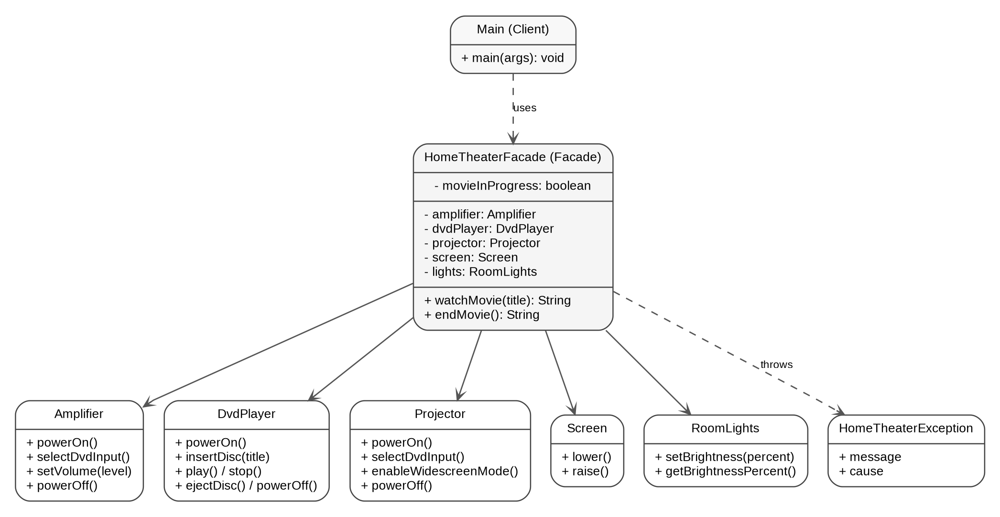

# Assignment 4 - Facade Pattern

Home Theater Facade | Software Design Patterns (ShP-2216) | Java 17

Student: [Your full name]

## 1. Introduction

For this assignment I chose Option B, Home Theater Facade. I wanted to use an example where one simple user action actually requires several smaller operations. Watching a movie sounds like a single task, but the screen has to go down, the lights should be dimmed, and the projector, amplifier and DVD player all need to be prepared in the right order.

Without a facade, the client would have to know which device should be started first and which settings are valid. For example, the DVD player cannot play without a disc, the amplifier needs an input before its volume is configured, and the projector requires a video input before switching to widescreen mode.

I implemented five subsystem classes: Amplifier, DvdPlayer, Projector, Screen and RoomLights. They store real state and check whether an operation is allowed. HomeTheaterFacade coordinates these classes through `watchMovie(String title)` and `endMovie()`. Main only uses the facade. This is a state-based simulation, not a controller for physical hardware.

## 2. UML Class Diagram



Main depends on HomeTheaterFacade, which coordinates five independent subsystem classes. None of the device classes refers back to the facade; advanced clients can use them directly.

## 3. Clean Code Requirements

I focused on Chapters 7 (Error Handling), 8 (Boundaries), and 9 (Unit Tests). The before examples are illustrative examples of approaches I avoided, while after examples reflect my implementation.

### 3.1. Fail fast with a useful exception (Chapter 7)

Returning false for invalid input would not tell the client what went wrong. Input validation runs before device setup.

Before: `if (title.isBlank()) return false;`

After:

```java
if (title == null || title.isBlank()) {
    throw new IllegalArgumentException("Movie title must not be blank.");
}
```

### 3.2. Preserve error context and recover safely (Chapter 7)

On a subsystem failure, the facade tries to restore standby mode and throws a contextual exception with the original cause; cleanup failures are suppressed.

Before: `throw new RuntimeException("Failed");`

After:

```java
catch (RuntimeException problem) {
    restoreStandby(problem);
    throw new HomeTheaterException(
        "Could not start movie '" + movieTitle + "'.", problem);
}
```

### 3.3. Keep device coordination at one boundary (Chapter 8)

The client should not repeat setup calls for different devices; those details belong behind a single entry point.

Before: `screen.lower(); lights.setBrightness(25); projector.powerOn(); // ...`

After:

```java
HomeTheaterFacade theater = new HomeTheaterFacade();
theater.watchMovie("Interstellar");
```

### 3.4. Do not expose subsystem objects in the public API (Chapter 8)

Returning a DvdPlayer would leak a concrete internal dependency.

Before: `public DvdPlayer watchMovie(String title);`

After: `public String watchMovie(String title);`

### 3.5. Give each test one clear purpose (Chapter 9)

Small, descriptively named tests make failures easier to understand.

Before: `void testEverything() { /* all scenarios */ }`

After:

```java
private static void blankTitleDoesNotStartTheater() {
    Fixture f = new Fixture();
    expect(IllegalArgumentException.class,
           () -> f.facade.watchMovie("  "));
    assertStandby(f);
}
```

### 3.6. Make tests fast, independent and self-checking (Chapter 9)

Every test uses fresh components, requires no hardware or external libraries, and fails automatically on a wrong state.

Before: `static HomeTheaterFacade shared = new HomeTheaterFacade();`

After:

```java
Fixture f = new Fixture();
f.facade.watchMovie("Interstellar");
check(f.dvdPlayer.isPlaying(), "DVD is not playing");
```

## 4. Conclusion

The facade hides device setup, shutdown and error recovery while keeping a simple API for ordinary clients. It does not prevent advanced clients from using the public device classes directly. The application compiled with the Java 17 language target and passed nine automated tests, including a simulated projector failure. A real hardware implementation would need extra device-specific handling.

## 5. GitHub Repository

Repository link: [Paste your GitHub repository URL here after publishing]

The repository contains source code, tests, a README, UML and incremental commits.
